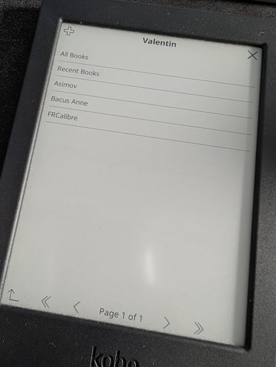
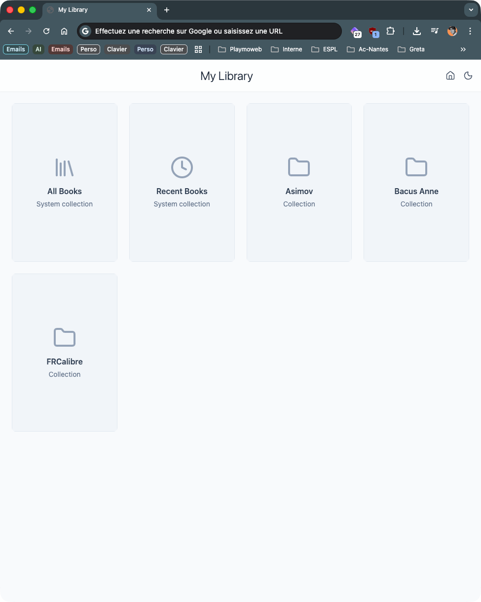
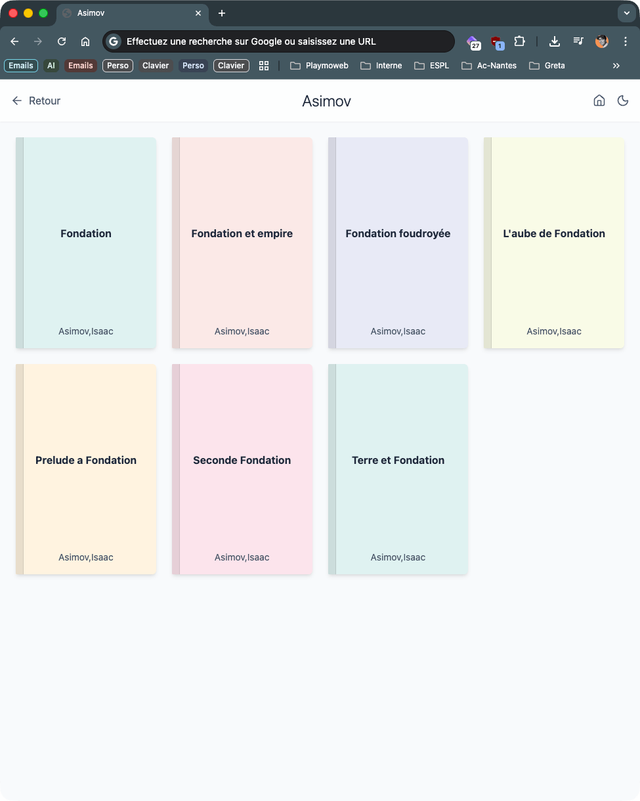
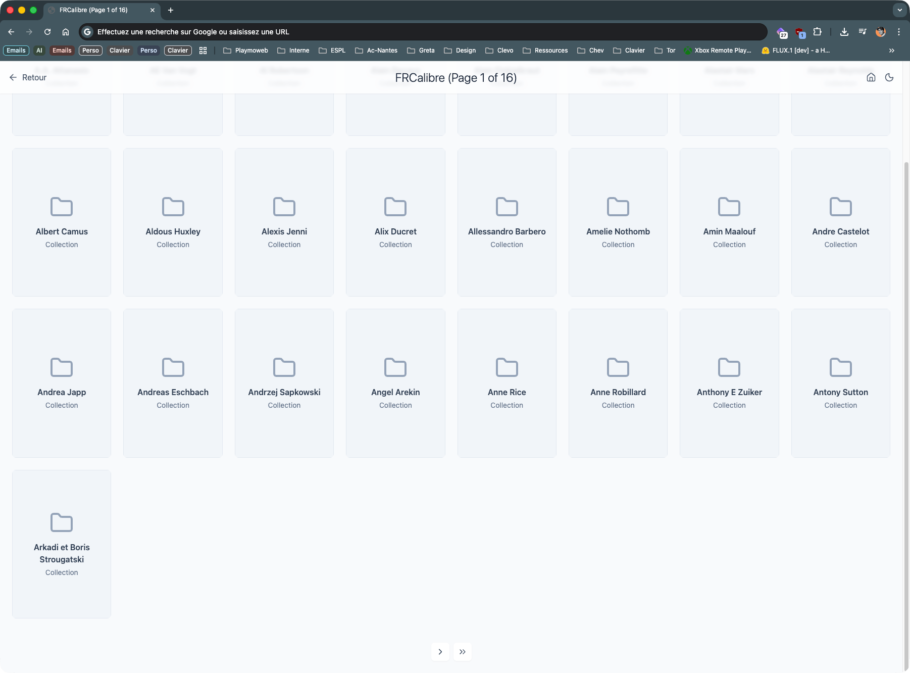

# PyOPDS Server - OPDS Server for EPUB Library

This project is a lightweight OPDS (Open Publication Distribution System) server written in Python 3, designed to expose a library of EPUB files stored in a local directory, compatible with clients like Calibre, KoReader, [CrossPoint](https://github.com/crosspoint-reader/crosspoint-reader) readers, or any other OPDS-compliant reader. It uses only Python's standard libraries.

It is also a reading progress sync server for KoReader and CrossPoint readers, compatible with the [CrossPoint Sync](https://github.com/crosspoint-reader/crosspoint-sync) app: library, reading statistics and clippings, with book details and covers taken from your EPUB library.



If you browse your OPDS feed in a web browser, it will display a simple HTML representation of the feed using XSLT transformation.





## Features

- **OPDS Catalog**: Exposes EPUB books via an OPDS feed accessible at the `/opds` endpoint.
- **OpenSearch**: Integrated search functionality compliant with OpenSearch specification, allowing users to search books by title, author or series.
- **Subdirectory Support**: Scans EPUB files in the configured directory and its subdirectories.
- **Sorted by Most Recent**: Books are listed in the OPDS feed sorted by modification date, with the most recently modified files appearing first.
- **Metadata Extraction**: Extracts title and author from EPUB files for rich display in the catalog.
- **Browse by Year, Author and Genre**: Genres come from the EPUB subjects (`dc:subject`); spelling variants are merged (SF, science-fiction...), technical tags and series names are ignored, and genres with fewer than 3 books are hidden. These rules live in [`genres.toml`](genres.toml) (see Configuration).
- **Book Covers**: Covers are extracted from the EPUB files and declared in the feed, so they show up in OPDS clients.
- **Book Details**: Series and volume, description, publication year and rating are read from the EPUBs (`calibre:series`, EPUB 3 collections, `dc:description`…) and shown in every book feed of the catalog (see [Book details in the feeds](#book-details-in-the-feeds)) and in the web UI book sheet, and served to the CrossPoint Sync app, including the next volume of a series. A series feed (`/opds/series?name=…`) lists the volumes of a series in order. Optional online lookups (Open Library, iTunes, Hardcover) fill the gaps for books outside the library.
- **Reading Sync API**: KOSync-compatible progress sync for KoReader and CrossPoint / CrossInk readers.
- **CrossPoint Sync Compatible**: Implements the [crosspoint-sync](https://github.com/crosspoint-reader/crosspoint-sync) extensions (`/api/v1`): the CrossPoint Sync app shows your library, reading statuses, statistics, activity and clippings, and CrossPoint readers sync rich positions and clippings.
- **Accounts**: the catalog is public; readers can sign in (or create an account) from the web UI or with HTTP Basic in their reading app, with the same account as the sync. `OPDS_AUTH=true` makes the whole catalog private.
- **« À lire ensuite » Recommendations**: once signed in, a tile and feed (`/opds/recommendations`) suggest unread books of the library from your reading sync history, computed locally.
- **Docker Deployment**: Prebuilt multi-arch image (`ghcr.io/c4software/pyopds-server`) published on each release, a versioned `docker-compose.yml` and a git-ignored override for your own settings.
- **Web Interface**: The OPDS feed rendered as a web page in browsers (XSLT transformation), with light/dark theme, search, sign-in / account creation and an optional animated mosaic of covers on the navigation tiles (see [Web interface](#web-interface)).
- **Reading Page**: `/reading` (chart icon in the web UI header) shows the books in progress per device with their last sync, finished and abandoned books, reading time, pages, a reading calendar, recent activity, devices and the latest highlights, with links to the matching books of the catalog; a synced book the server could not match can be associated by hand with a book of the library.

## Prerequisites

- **Python 3.12+** (if running without Docker).
- **Docker** and **Docker Compose** (for containerized deployment).
- A directory containing EPUB files (e.g., `books/`).

## Installation

### With Docker

1. Clone the repository:

   ```bash
   git clone https://github.com/c4software/pyopds-server.git
   cd pyopds-server
   ```

2. Create a `books/` directory and place your EPUB files in it (e.g., `books/author1/book.epub`).
3. Start the server with Docker Compose:

   ```bash
   docker compose up -d          # prebuilt image (see below)
   docker compose up -d --build  # or built from this checkout
   ```

4. Access the OPDS catalog at: `http://localhost:8080/opds`.

The prebuilt image (amd64, arm64) is published by GitHub Actions on each release tag to `ghcr.io/c4software/pyopds-server`, as `latest` and as the tag version (e.g. `2.4.0`):

```bash
docker run -p 8080:8080 -v ./books:/books ghcr.io/c4software/pyopds-server:latest
```

Machine-specific settings (library path, pinned version, reverse proxy, extra variables) go in a git-ignored `docker-compose.override.yml`, merged automatically by Compose: start from [`docker-compose.override.example.yml`](docker-compose.override.example.yml). Update with `docker compose pull && docker compose up -d`.

### Without Docker

1. Clone the repository:

   ```bash
   git clone https://github.com/c4software/pyopds-server.git
   cd pyopds-server
   ```

2. Set the environment variable for the books directory:

   ```bash
   export LIBRARY_DIR=/path/to/your/books
   ```

3. Build the web UI stylesheet once (see [Web UI styles](#web-ui-styles)):

   ```bash
   python tools/tailwind.py
   ```

4. Start the server:

   ```bash
   python server.py
   ```

5. Access the OPDS catalog at: `http://localhost:8080/opds`.

### Development (Docker, hot reload)

```bash
docker compose -f docker-compose.dev.yml up --build
```

The source is mounted into two containers built from the `dev` stage of the [`Dockerfile`](Dockerfile):

- `app` serves `http://localhost:8080` and restarts on every change of the Python code or `genres.toml` ([watchfiles](https://watchfiles.helpmanual.io/)); EPUBs are read from `./books`, the sync database is kept in `./config`. Changes to `static/` (XSLT, pages, scripts) need no restart: reload the page.
- `css` rebuilds `static/tailwind.css` whenever Tailwind classes change in `static/` (Tailwind CLI `--watch`).

With rootful Docker, set `DEV_UID` / `DEV_GID` (e.g. in a `.env` file: `DEV_UID=1000`) so that the rebuilt stylesheet belongs to you; rootless Docker needs nothing.

### Releasing

Commits go to `main`; a version is published by pushing a tag (plain [semantic version](https://semver.org), no `v` prefix: `2.9.0`), which triggers the [`Docker image`](.github/workflows/docker.yml) workflow (image `latest` and `<version>`, amd64 and arm64):

```bash
python -m unittest discover tests        # tests must pass
git push                                 # commits on main
git tag 2.9.1 && git push origin 2.9.1   # new version: minor for a feature, patch for a fix
gh release create 2.9.1 --title 2.9.1 --notes "…"   # release notes on GitHub
gh run watch                             # wait for the image build
```

Then update the servers: `docker compose pull && docker compose up -d`.

## Configuration

The following environment variables can be set:

- **LIBRARY_DIR**: Path to the directory containing EPUB files (default: `books`; `/books` in the Docker image).
- **PORT**: Listening port (default: `8080`).
- **PAGE_SIZE**: Number of books per page in the OPDS feeds (default: `25`).
- **KOREADER_SYNC_DB_PATH**: Path to the SQLite database file used by the KoReader sync helper (default: `koreader_sync.db`).
- **REGISTRATION_DISABLED**: Set to `true` to refuse new accounts, from the readers as well as from the web sign-in page (default: registration open).
- **OPDS_AUTH**: Set to `true` to make the whole catalog and web UI private (default: public catalog, optional sign-in). See [Accounts and sign-in](#accounts-and-sign-in).
- **OPDS_SESSION_SECRET**: Key signing the browser sessions (default: a random key written once to `session.secret` next to the sync database).
- **GENRES_CONFIG_PATH**: Path to a custom genre file completing [`genres.toml`](genres.toml), with the same format: its subject-to-genre aliases and ignored subjects are added to the default ones (and win over them), and its `min_books` overrides the default threshold. Restart the server after editing it. Example (for instance in the mounted `config/` folder):

  ```toml
  ignored = ["my series", "release team"]

  [aliases]
  "Science-fiction" = ["cyberpunk"]
  ```
- **ONLINE_METADATA**: Set to `true` to look up, without any API key, the cover ([iTunes Search](https://performance-partners.apple.com/search-api), then [Open Library](https://openlibrary.org/developers/api)), print page count and description (Open Library) of synced books the library does not provide (default: disabled).
- **HARDCOVER_API_KEY**: [Hardcover](https://hardcover.app/account/api) API key (`read:catalog` is enough) to add moods, genres, content warnings, community rating, series and position, release year and description to synced books, and the next book of a series (`GET /api/v1/documents/{document}/next`) (default: disabled). Requests are throttled (1.1 s apart, 4,000 a day, 10 min pause after a 429).

  Online lookups are only a fallback: they run for books that match no EPUB of the library, and their results only fill fields the library and the reader left empty. Only the book's **title, author and ISBN** are sent to those services (with a `PyOPDS-Server` User-Agent), never anything about the user. They run in a background thread (at most 10 books per `GET /api/v1/progress`), never while answering a request, except the cover picker (`GET /api/v1/documents/{document}/cover/candidates`) which searches live. Results are cached for every user in the `catalog_cache` table of the sync database (30 days; misses 7 days for Open Library, 30 days for Hardcover; series 7 days).

For Docker, set these variables in `docker-compose.override.yml` (see above); the base `docker-compose.yml` already mounts `./books` and `./config` (sync database, custom genres, session key). For example:

```yaml
services:
  cops:
    # Pin a version instead of following `latest`
    image: ghcr.io/c4software/pyopds-server:2.4.0
    volumes:
      - /srv/epub:/books        # replaces the ./books volume of the base file
    environment:
      - REGISTRATION_DISABLED=true
      - ONLINE_METADATA=true
```

Check the merged configuration with `docker compose config`.

## Usage with an OPDS Client

1. In an OPDS-compatible client (e.g., KoReader, Calibre, or the *Browse* tab of the CrossPoint Sync app):
   - Add a new catalog with the URL: `http://<your-ip>:8080/opds`.
2. Browse the book list at the `/opds/books` endpoint.
3. Download books via the links provided in the OPDS feed.

### Book details in the feeds

Every book entry (all books, recent, folders, years, authors, genres, search, « À lire ensuite », series) carries the metadata of its EPUB, read from the OPF only (no cover, no text) for the books of the current page, and cached per file modification time:

- `<summary type="text">`: the description (`dc:description`, HTML turned into text, paragraphs kept). In « À lire ensuite », the reasons of the suggestion come first, then a blank line and the description.
- `<category term="…" label="…"/>`: the genres (see « By Genre »).
- `<dc:issued>`: the publication year (`xmlns:dc="http://purl.org/dc/terms/"`).
- Series: a standard Atom link `<link rel="related" href="/opds/series?name=…" type="…kind=acquisition" title="Série : … (tome N)"/>` to the other volumes, plus `<pyopds:series index="N">name</pyopds:series>` and `<pyopds:rating>` (0-5) in the server's namespace `urn:pyopds:metadata`. OPDS 1.x has no element for series and rating and clients share no convention for them (Calibre's own feed only writes them as text), so other clients just ignore these two.
- Navigation from the book: titled `rel="related"` links to its author (`Auteur : …`) and to each of its genres (`Genre : …`), after the series one. The CrossPoint Sync app lists them under « More like this »; in the web UI book sheet, the author, the series and the genre tags are links.
- `GET /opds/series?name=<series>`: the library books of that series, sorted by volume (books without a volume last), series names compared ignoring case, accents and punctuation; 404 when no book has it.

Navigation entries only list the links clients need: the cover mosaic links of the web view (`rel="urn:pyopds:mosaic-cover"`) are only sent to browsers (`Accept: text/html`), never to OPDS clients, which may list every link of a navigation entry as a section.

### Web interface

Opening the catalog URL in a browser shows it as a web page: the browser turns the feed into HTML with [`static/opds_to_html.xslt`](static/opds_to_html.xslt), so browsers and OPDS clients read the very same feed. Browsers without native XSLT (Chrome removes it in version 158, November 2026) use [xslt-polyfill](https://github.com/mfreed7/xslt_polyfill), the XSLT engine compiled to WebAssembly (BSD-3, `static/xslt-polyfill.min.js`): every feed references it, it is only downloaded when native XSLT is missing (1.5 MB, cached for a year), and OPDS clients ignore it. Styles come from a compiled Tailwind stylesheet (see [Web UI styles](#web-ui-styles)), so they also work with the polyfill.

The header holds the search field and these buttons:

- **Home**, **Reading page** (chart icon, see [Reading page](#reading-page-web-ui)) and **Refresh** (rescans the library and clears the caches).
- **Se connecter** / **logout**: optional sign-in (see below), which shows the « À lire ensuite » tile.
- **Cover mosaic** (image icon): fills the navigation tiles (collections, authors, years, genres, folders) with an animated mosaic of the covers of their books, under a veil that keeps the text readable. It is off by default and remembered per browser. Covers are only requested while it is on; small thumbnails, books without a cover and the covers last shown on each tile are cached in the browser (IndexedDB, 7 days), so tiles fill at once on the next visits.
- **Theme**: light or dark, remembered per browser.

A click on a book opens its **book sheet** (a dialog closed with Escape, a click outside or the close button) instead of downloading it: large cover, title, author (link, with a person icon, to all the books of the author), « Tome N · Série » (link to the series feed), year, rating (stars), genres (tag chips linking to the genre feeds), description (« Lire la suite » when long) and a **Télécharger** button. A middle click or Ctrl/⌘-click still downloads the book, as does a click without JavaScript; the address of an opened sheet (`#book=…`) can be shared. Series books show their volume (« T2 ») on their tile.

**Files.** The XSLT only holds the page structure; the page code lives next to it:

| File | Role |
| --- | --- |
| `static/opds_to_html.xslt` | Feed → HTML: header, tiles, pagination, book sheet markup (plus a tiny inline script setting the dark theme before the first paint) |
| `static/catalog/catalog.css` | Styles Tailwind utilities cannot express: tile colors, cover fade-in, mosaic, book sheet dialog, rating stars (served as is, after `tailwind.css`) |
| `static/catalog/main.js` | Entry point: starts every feature below (loaded last) |
| `static/catalog/theme.js` | Light/dark theme button |
| `static/catalog/back-button.js` | « Retour » link to the parent feed |
| `static/catalog/search.js` | Search query pre-fill, full-width search bar on phones |
| `static/catalog/account-button.js` | « Se connecter » / logout button |
| `static/catalog/covers.js` | Lazy loading of the book covers |
| `static/catalog/mosaic.js` | Cover mosaic of the navigation tiles and its button |
| `static/catalog/cover-cache.js` | Browser cache of the mosaic (IndexedDB thumbnails, covers last shown) |
| `static/catalog/pagination.js` | Numbered pagination, first/last page links |
| `static/catalog/book-sheet.js` | Book sheet dialog, `#book=` links |

They are plain scripts sharing a small `window.PyOPDS` namespace, loaded in order by `<script src>` tags at the end of the page: this runs the same with native XSLT and with the polyfill (which re-creates the scripts of the result one after the other, then dispatches `DOMContentLoaded`). The server adds `?v=<modification time>` to every `/static/…` URL of the XSLT it serves (as for the other pages): versioned files are cached for a year, and a deployment changes their URLs, so browsers and caching proxies never mix old and new scripts. Files of `static/` and of one level of sub-folder (`static/catalog/`) are served; Tailwind classes used in these scripts are picked up by `python tools/tailwind.py`.

### Accounts and sign-in

The catalog is **public**: anyone can browse and download. Signing in is optional and enables what depends on the reader, the « À lire ensuite » recommendations (`/opds/recommendations` always requires an account). With `OPDS_AUTH=true` the whole catalog is private: `/`, every `/opds…` feed (search, OpenSearch, refresh included), `/download/…`, `/opds_to_html.xslt` and `/reading`.

The accounts are the **sync accounts** (created from the web UI, KoReader, a CrossPoint reader or the CrossPoint Sync app): the server checks the MD5 of the password against the stored sync key. UTF-8 passwords are supported.

- **OPDS clients** (KoReader, CrossPoint readers, the CrossPoint Sync app) use HTTP Basic (`WWW-Authenticate: Basic realm="PyOPDS", charset="UTF-8"`): enter the user name and password in the catalog settings.
- **Browsers** use the sign-in page `/login` (the « Se connecter » button of the header, or a redirect when an account is required). It also **creates accounts** (unless `REGISTRATION_DISABLED`). One sign-in opens a session (signed `HttpOnly` cookie, 90 days) for the catalog **and** the reading page; the header shows a logout button (`/logout`). The signing key is `OPDS_SESSION_SECRET` when set, otherwise a random key written once to `session.secret` next to the sync database.

Left public on purpose: the page assets `/static/…` (no library data), the whole sync API (KOSync at the root and under `/koreader/sync`, `/api/v1/…`, `/healthz`), which keeps its own `x-auth-user` / `x-auth-key` authentication, `/cover/…` (the CrossPoint Sync app shows covers with plain image requests) and the `/health` monitoring probe. Basic authentication sends the password in clear text: use HTTPS (reverse proxy) when exposing the server.

### « À lire ensuite » recommendations

Once signed in, the root catalog shows an **« À lire ensuite »** tile linking to the acquisition feed `/opds/recommendations`: up to 30 books of the library **you never opened**, suggested from your reading sync history and computed locally (no third-party service):

- books read (marked finished or read to 90 % or more) or in progress (paused ones count less) whose synced document matches a library EPUB build your profile; abandoned books (`dnf`) are ignored;
- each candidate scores for the **same author**, **shared genres** (see « By Genre ») and the **next volume of a series** you started (when the series metadata of the EPUBs is available); recent reads weigh more than old ones;
- each entry's summary explains why it is suggested.

Results are cached for 5 minutes per user and refreshed as soon as a new sync arrives. With an empty history, the feed is empty with an explanatory subtitle. Browsers without an account see the « Se connecter » button instead of the tile; OPDS clients always see the tile, and opening it asks for their credentials (HTTP Basic).

## Sync API (KoReader, CrossPoint)

The server includes a KOSync-compatible progress sync server, plus the CrossPoint Sync extensions (`/api/v1`) used by CrossPoint / CrossInk readers and the CrossPoint Sync app. Every endpoint is available both at the server root and under `/koreader/sync`.

Data is stored in a local SQLite database (`KOREADER_SYNC_DB_PATH`). Databases created by older versions are migrated automatically on the first sync request; back the file up before upgrading.

### KOSync endpoints

- `POST /users/create`, `GET /users/auth`: account creation and login (`x-auth-user` / `x-auth-key` headers, key = MD5 of the password).
- `PUT /syncs/progress`: stores a device's position. Each device keeps its own record; the most recent one wins.
- `GET /syncs/progress/{document}`: newest position of a book across devices.
- `GET /healthz`: health probe.

Errors, status codes and timestamps follow the reference KOSync server.

### Configuring the readers

- **KoReader**: *Tools → Progress sync → Custom sync server* = `http://<your-ip>:8080/koreader/sync`.
- **CrossPoint / CrossInk**: *Settings → KOReader Sync → Sync Server URL* = `http://<your-ip>:8080/koreader/sync` (or the root URL). Choose the *CrossPoint* (or *Other*) server type to sync rich positions; enable clippings sync in the same settings.
- **CrossPoint Sync app** (*Self-hosted*): `http://<your-ip>:8080`. Library, statuses, reading dates, merge of duplicate copies, reading statistics and activity, clippings and account management work. When a synced book matches an EPUB of the library (KoReader content hash, file name hash or file name), its title, author, cover and an estimated print page count come from the library.

### CrossPoint Sync extensions (`/api/v1`)

- Progress: `PUT /progress`, `PUT /progress/batch`, `GET /progress`, `GET /progress/changes`, `GET|DELETE /progress/{document}`.
- Documents: `PUT|GET /documents`, `PUT /documents/{document}/status|dates|info`, `GET /documents/{document}/cover|cover/candidates|about|next|matches`, `POST /documents/merge`, `DELETE /documents/merge/{alias}`.
- Statistics: `PUT|GET /stats/global`, `PUT /stats/books`, `GET /stats/books/{document}`, `GET /stats/summary`, `GET /stats/activity?tz=`.
- Clippings and bookmarks: `GET /clippings`, `GET|PUT /clippings/{document}`, `GET|PUT /bookmarks/{document}`.
- Account: `POST /account/password`, `DELETE /account/data`, `DELETE /account`.

`GET /api/v1/progress` also returns `library_path`, the path of the matching library EPUB (or `null`), used by the reading page for its catalog and download links. When the hashes match no EPUB (file changed since, or sent another way), `PUT /api/v1/documents/{document}/info` accepts `library_path` (relative to `LIBRARY_DIR`, `null` to remove) to associate the document by hand: the reading page offers it with « Associer à un livre », and `library_linked` is then `true`.

Book metadata is provided locally, without any third-party service, from the library EPUB (OPF) matching the synced document:

- `GET /api/v1/progress`: `series` and `series_position` (`calibre:series` / `calibre:series_index`, or the EPUB 3 `belongs-to-collection` of type `series` with its `group-position`), `release_year` (`dc:date`) and `rating` (`calibre:rating`, 0-5). For a book missing from the library, the series and series index sent by CrossPoint readers with their progress (server type *Other*) are used; the ISBN they send is stored too.
- `GET /api/v1/documents/{document}/about`: the EPUB's `dc:description`, HTML converted to plain text (paragraphs and line breaks kept, cut at about 6000 characters).
- `GET /api/v1/documents/{document}/next`: the next volume of the series found in the library (series names compared ignoring case, accents and punctuation; whole-numbered volumes preferred over novellas like 1.5), with its absolute cover URL. The app's « Find it in your catalogs » button then finds it by title with the OPDS search.

When `ONLINE_METADATA` / `HARDCOVER_API_KEY` are set (see Configuration), online lookups fill what the library leaves empty: cover, page count, description, Hardcover moods, genres, content warnings, rating, series and next-in-series.

The connectors of crosspoint-sync (Hardcover, Spotify, Readwise... progress sync) are not provided: `GET /api/v1/connectors` returns an empty list and the app hides those features.

### Reading page (web UI)

`/reading` is a static page (`static/reading.html`, `reading.js`, `reading.css`) that calls the sync API from the browser with the `x-auth-user` / `x-auth-key` headers: progress (`/api/v1/progress`, and `/api/v1/progress/{document}` for the per-device positions), `/api/v1/stats/summary`, `/api/v1/stats/activity` and `/api/v1/clippings`. It uses the common sign-in page: the sign-in opens the catalog session and keeps the user name and the MD5 of the password in the browser's `localStorage` until you sign out. Reading time, time of day and weekday charts need readers that upload statistics (CrossPoint); with KoReader alone, pages and reading days come from the progress history.

A synced book that matches no EPUB of the library (shown by its document hash, e.g. a file changed since it was downloaded, or sent to the reader another way) has an **« Associer à un livre »** button: search the catalog and pick the book; its title, cover, pages and links then come from that EPUB (« Dissocier » removes the association).

The reading and sign-in pages are written with [Alpine.js](https://alpinejs.dev) (3.17.4, pinned, loaded from jsDelivr, no build step): the templates are in the HTML (`x-for`, `x-text`…), the scripts only call the API and compute the view data (`Alpine.data('reading')`, `Alpine.data('login')`); `static/theme.js` holds the shared light/dark toggle.

The page assets are served with a version (`/static/reading.js?v=<modification time>`), so that a reverse proxy caching static files never serves an outdated script after an update.

## Web UI styles

The web UI uses [Tailwind CSS](https://tailwindcss.com) v3, compiled into `static/tailwind.css` (not versioned) by the official [standalone CLI](https://tailwindcss.com/blog/standalone-cli), which needs no Node.js:

```bash
python tools/tailwind.py          # build static/tailwind.css (minified)
python tools/tailwind.py --watch  # rebuild on every change of static/
```

[`tools/tailwind.py`](tools/tailwind.py) downloads the pinned CLI version once (checked against its SHA-256) into `.cache/`, then runs it with [`tailwind.config.js`](tailwind.config.js) (dark mode by class, classes scanned in `static/*.xslt|html|js` and `static/catalog/*.js`) and [`styles/tailwind.css`](styles/tailwind.css). Extra arguments go to the Tailwind CLI. The Docker image builds the stylesheet itself (`css` stage of the Dockerfile), and the development compose file rebuilds it on every change.

## Duplicate books

A command line tool finds the duplicate EPUBs of the library (`LIBRARY_DIR`), and can remove them:

```bash
python -m controllers.duplicates                         # report only
python -m controllers.duplicates --json                  # report as JSON
python -m controllers.duplicates --move-to ../doublons   # move the extra copies out of the library
python -m controllers.duplicates --delete                # delete the extra copies
# In the Docker image
docker exec cops python -m controllers.duplicates --move-to /config/doublons
```

- **Identical files** (same SHA-256), wherever they are stored.
- **Same book**: different files whose metadata give the same title, author (word order, case, accents and punctuation ignored: "Asimov, Isaac" = "Isaac Asimov") and series position, with texts of similar lengths (`--identical-only` skips them).
- **To check**: same metadata but texts of very different lengths (one volume of a book published in several, abridged edition…): reported, never removed.

In each group one file is kept: the one already read on a reader (known to the sync database, so its progress stays attached to a library book), then the one with a cover, a readable file name containing the title (not garbled by a wrong encoding), metadata, the largest file, the oldest. Folders left empty are removed. `--move-to` must be outside the library, otherwise the copies would still appear in the catalog.

## Security Consideration

This server is designed to be lightweight and does not include HTTPS support; the catalog is public unless `OPDS_AUTH=true`, and passwords travel in clear text over plain HTTP. For production use, it is strongly recommended to place the server behind a reverse proxy (e.g., SWAG, Nginx, or Nginx Proxy Manager).

## License

This project is licensed under the MIT License. See the `LICENSE` file for details (to be added if necessary).
