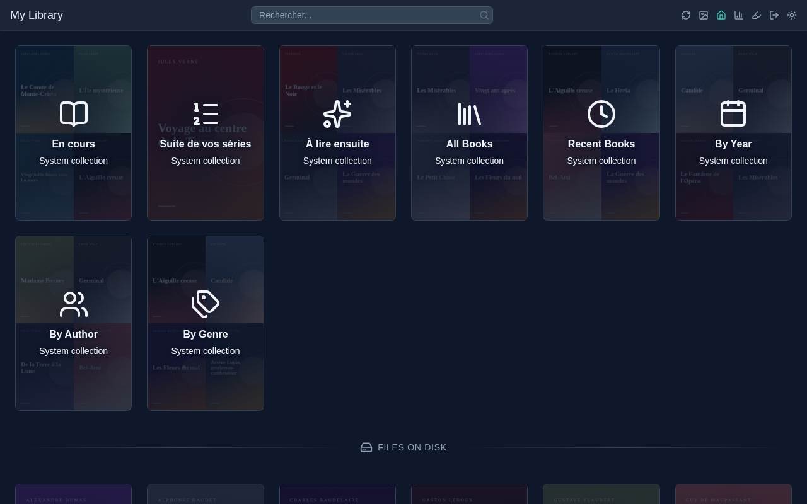
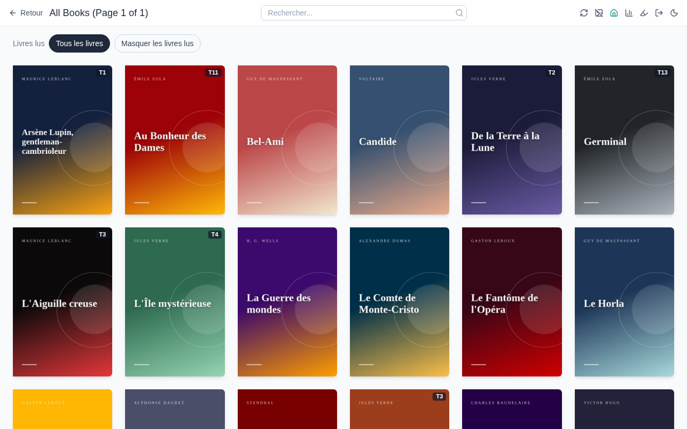
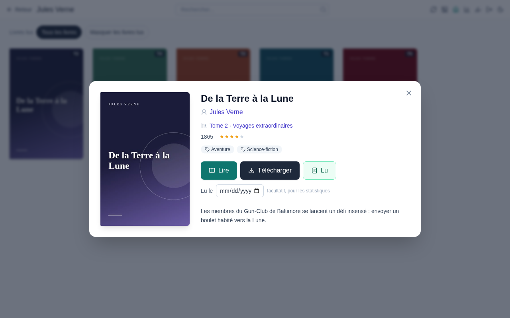
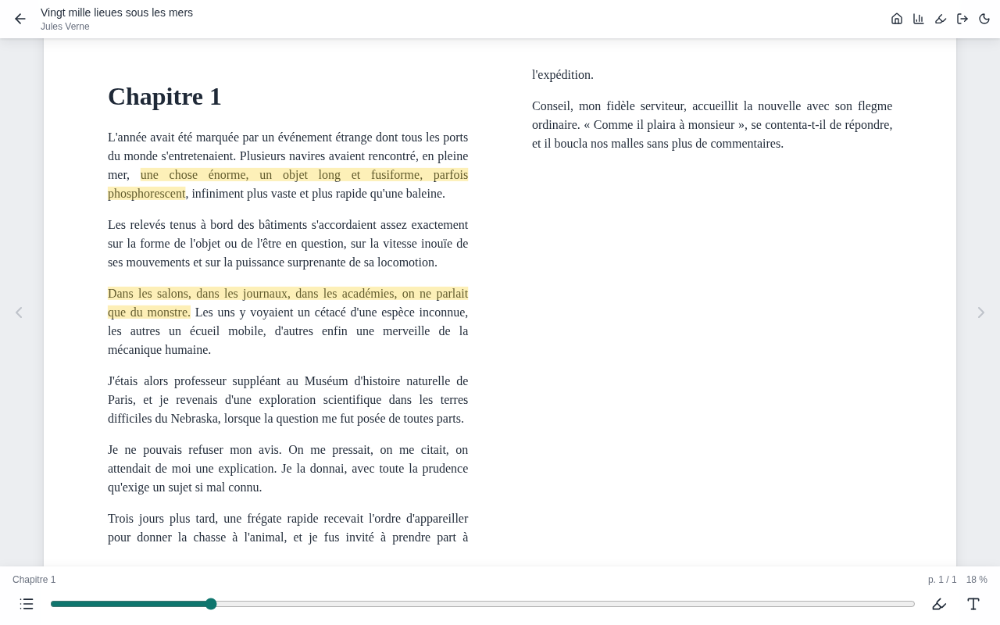
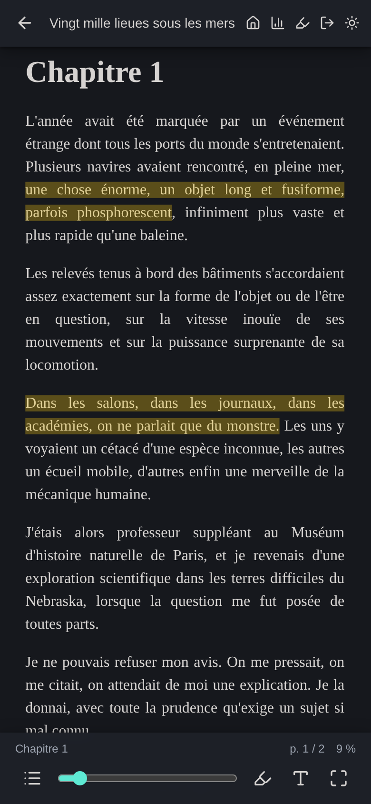
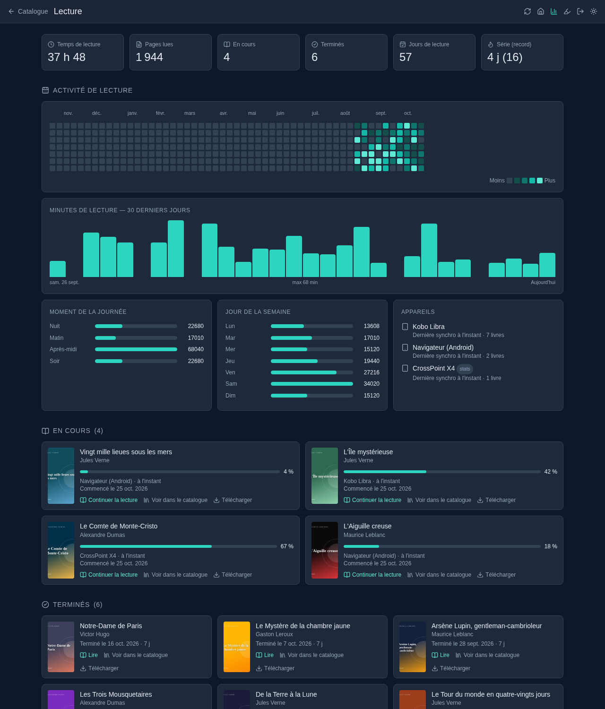
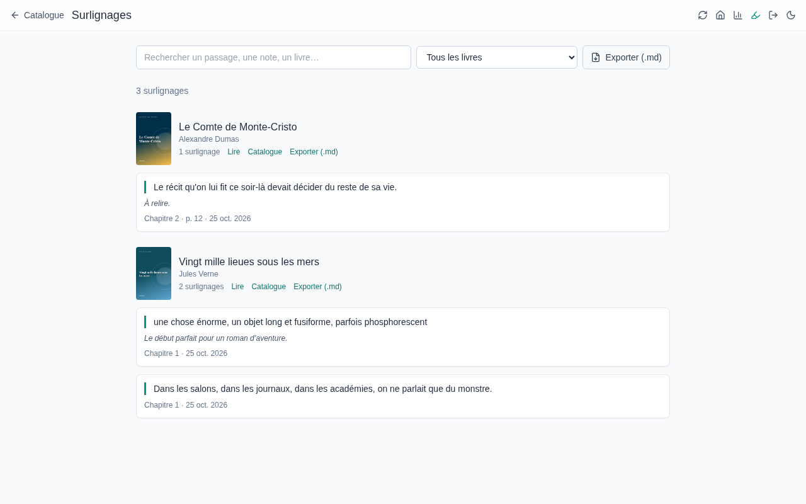
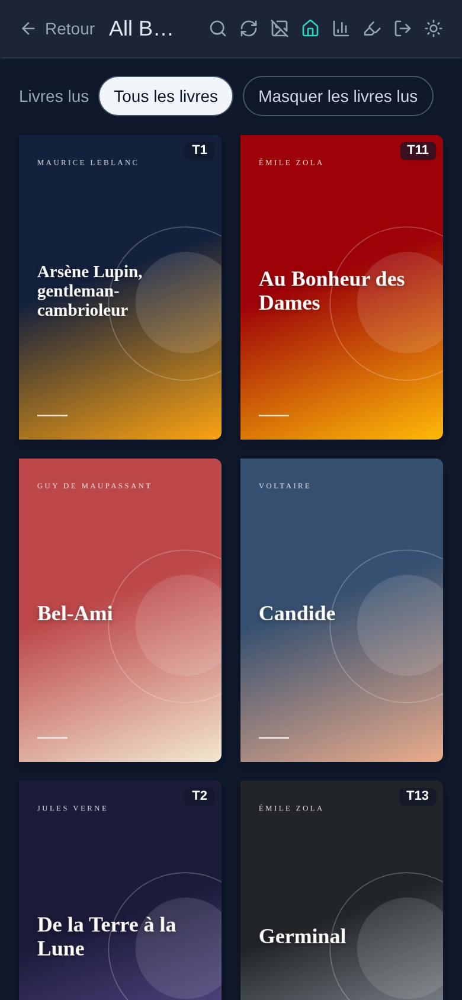

# PyOPDS Server

**Your EPUB library, everywhere you read.** A lightweight, self-hosted OPDS catalog for your EPUB files, with a beautiful web interface, a reader in the browser and reading progress sync for KoReader and [CrossPoint](https://github.com/crosspoint-reader/crosspoint-reader) e-readers. Pure Python, no dependencies.



- 📚 **Drop your EPUBs in a folder**: they are listed by author, year, genre, series and folder, with covers, descriptions and ratings read from the books.
- 📱 **Browse from any reader**: KoReader, CrossPoint readers, the CrossPoint Sync app, Calibre or any OPDS client, plus a web interface for your phone and computer.
- 📖 **Read in the browser**: open any book from the catalog, on a phone, a tablet or a computer, and pick it up on your e-reader where you stopped.
- 🔄 **Sync your reading**: positions, highlights and reading statistics shared between KoReader, CrossPoint readers, the CrossPoint Sync app and the web reader.
- 🪶 **Light and simple**: Python standard library only, one Docker image (amd64, arm64), one folder of EPUBs, one SQLite file for the metadata.

## A catalog that looks good

Every book shows its cover, series and volume; a click opens its sheet with the description, rating, genres, and buttons to read it online or download it. Light and dark themes, search, an animated cover mosaic on the collection tiles.

<table>
  <tr>
    <td width="50%"></td>
    <td width="50%"></td>
  </tr>
</table>

## Read anywhere, continue anywhere

The web reader opens your books right in the browser (no download): full screen on phones, two pages side by side on tablets and computers, display settings, table of contents and highlights in four colors. Signed in, your position and highlights follow you between the browser, KoReader and your CrossPoint reader: open the book on another device and it offers to resume where you left off.

<table>
  <tr>
    <td width="68%"></td>
    <td width="32%"></td>
  </tr>
</table>

## Your reading, at a glance

Once signed in, the catalog starts with your shelves: **En cours** (books being read), **Suite de vos séries** (the next volume of your series) and **À lire ensuite** (recommendations computed locally from what you read). The reading page gathers the books in progress per device, finished books, reading time, a reading calendar and your devices; all your highlights are one click away, searchable and exportable to Markdown.

<table>
  <tr>
    <td width="50%"></td>
    <td width="50%"><br><br></td>
  </tr>
</table>

The web interface installs like an app on your phone (« Add to Home Screen »).

## And on your e-reader

The same catalog is a standard OPDS feed: add it to KoReader, a CrossPoint reader, the CrossPoint Sync app or Calibre and download books directly.


<details>
<summary><strong>All features</strong></summary>

- **OPDS Catalog**: Exposes EPUB books via an OPDS feed accessible at the `/opds` endpoint.
- **OpenSearch**: Integrated search functionality compliant with OpenSearch specification, allowing users to search books by title, author or series.
- **Subdirectory Support**: Scans EPUB files in the configured directory and its subdirectories.
- **Library metadata in SQLite**: each EPUB is read once; the library is synced at startup, every 4 hours (configurable) and from the « Recharger » button (see [Catalog and library](docs/catalog.md#library-metadata)).
- **Browse by Year, Author and Genre**: Genres come from the EPUB subjects (`dc:subject`); spelling variants are merged (SF, science-fiction...), technical tags and series names are ignored, and genres with fewer than 3 books are hidden. These rules live in [`genres.toml`](genres.toml) (see [Configuration](docs/installation.md#configuration)).
- **Book Covers**: Covers are extracted from the EPUB files and declared in the feed, so they show up in OPDS clients.
- **Book Details**: Series and volume, description, publication year and rating are read from the EPUBs (`calibre:series`, EPUB 3 collections, `dc:description`…) and shown in every book feed of the catalog (see [Book details in the feeds](docs/catalog.md#book-details-in-the-feeds)) and in the web UI book sheet, and served to the CrossPoint Sync app, including the next volume of a series. A series feed (`/opds/series?name=…`) lists the volumes of a series in order. Optional online lookups (Open Library, iTunes, Hardcover) fill the gaps for books outside the library.
- **Reading Sync API**: KOSync-compatible progress sync for KoReader and CrossPoint / CrossInk readers.
- **CrossPoint Sync Compatible**: Implements the [crosspoint-sync](https://github.com/crosspoint-reader/crosspoint-sync) extensions (`/api/v1`): the CrossPoint Sync app shows your library, reading statuses, statistics, activity and clippings, and CrossPoint readers sync rich positions and clippings.
- **Accounts**: the catalog is public; readers can sign in (or create an account) from the web UI or with HTTP Basic in their reading app, with the same account as the sync. `OPDS_AUTH=true` makes the whole catalog private.
- **Minimal mode**: `MINIMAL_MODE=true` keeps the OPDS catalog and its web view only (no sync, no web reader, no reader pages).
- **« À lire ensuite » Recommendations**: once signed in, a tile and feed (`/opds/recommendations`) suggest unread books of the library from your reading sync history, computed locally.
- **Personal shelves**: once signed in, the root catalog starts with « En cours » (books being read) and « Suite de vos séries » (next volume of your series), and every book list can hide the books you finished (« Masquer les livres lus »).
- **Docker Deployment**: Prebuilt multi-arch image (`ghcr.io/c4software/pyopds-server`) published on each release, a versioned `docker-compose.yml` and a git-ignored override for your own settings.
- **Web Interface**: The OPDS feed rendered as a web page in browsers (XSLT transformation), with light/dark theme, search, sign-in / account creation and an optional animated mosaic of covers on the navigation tiles (see [Web interface](docs/web-ui.md#catalog-in-the-browser)).
- **Web Reader**: « Lire » in the book sheet opens the EPUB in the browser (`/read`, [foliate-js](https://github.com/johnfactotum/foliate-js)), on phones (full screen, taps and swipes, screen kept on), tablets (two pages side by side in landscape) and computers (centered reading page). Once signed in, the position, the clippings and the reading time are those of your sync account: continue on KoReader or a CrossPoint reader where the browser stopped, and the other way round (see [Web reader](docs/web-ui.md#web-reader)).
- **Audiobook**: with a text-to-speech server (an OpenAI-compatible one, `audiobook.toml`), « Écouter » reads the book aloud in the web reader, a few paragraphs at a time (never the whole book, the voice keeping its tone across them), the sentence read underlined and the pages following it; each book gets its own voice and reading tone, a free prompt (« voix grave, ton de conteur »), and voices can be cloned from a recording designed from a description (see [Audiobook](docs/audiobook.md)).
- **Installable**: the web UI is a web app (manifest, icons): « Add to Home Screen » / « Install » opens it like an app (HTTPS required by the browsers).
- **Reading Page**: `/reading` (chart icon in the web UI header) shows the books in progress per device with their last sync, finished and abandoned books, reading time, pages, a reading calendar, recent activity, devices and the latest highlights, with links to the matching books of the catalog; a synced book the server could not match can be associated by hand with a book of the library.
- **KoReader highlights**: KoReader's « Nextcloud Notes » export lands in the server as highlights of the book.
- **Library tools**: command line tools to find duplicate books and to fix metadata in bulk through a CSV file (see [Library tools](docs/tools.md)).

</details>

## Quick start

```bash
git clone https://github.com/c4software/pyopds-server.git
cd pyopds-server
mkdir -p books && cp /path/to/your/*.epub books/
docker compose up -d
```

Open `http://localhost:8080/opds` in your browser, or add it as a catalog in your reading app. Or without cloning:

```bash
docker run -p 8080:8080 -v ./books:/books ghcr.io/c4software/pyopds-server:latest
```

Then, for reading sync, point KoReader (*Tools → Progress sync → Custom sync server*) or your CrossPoint reader to `http://<your-server>:8080/koreader/sync`. Need a smaller server? `MINIMAL_MODE=true` keeps the catalog and its web view only.

## Documentation

| Guide | What's inside |
| --- | --- |
| [Installation and configuration](docs/installation.md) | Docker and plain Python installs, every environment variable, connecting OPDS clients and readers, accounts, security |
| [Catalog and library](docs/catalog.md) | How the library is read and kept up to date, book details in the feeds, recommendations, personal shelves |
| [Web interface](docs/web-ui.md) | The catalog in the browser, the web reader, the reading and highlights pages |
| [Sync API](docs/sync-api.md) | KOSync and CrossPoint Sync endpoints |
| [Audiobook](docs/audiobook.md) | « Écouter » in the web reader: text-to-speech server, settings, ready-made and cloned voices, making a voice |
| [Library tools](docs/tools.md) | Finding duplicate books, fixing metadata (genres, authors, titles) in bulk, making an audiobook voice |
| [Development](docs/development.md) | Hot-reload environment, tests, styles, releasing |

## License

MIT, see [LICENSE](LICENSE). Bundled: [foliate-js](https://github.com/johnfactotum/foliate-js) (MIT), [xslt-polyfill](https://github.com/mfreed7/xslt_polyfill) (BSD-3), [Lucide](https://lucide.dev) icons (ISC).
